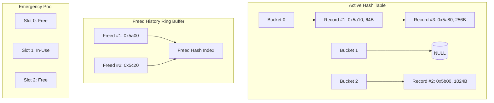

# Dynamic Memory Allocation Tracker and Memory Leak Detector in C

A robust, thread-safe dynamic memory tracking and memory leak detection library in C11. This tool wraps standard memory allocation functions (`malloc`, `calloc`, `realloc`, `free`) to maintain active allocation records with exact source file and line locations, detect memory leaks at program exit via `atexit()`, and diagnose critical memory management errors such as double-frees and freeing untracked pointers without crashing.

Tested and fully compatible with **Ubuntu on WSL (Windows Subsystem for Linux)** using GCC and standard GNU tools.

---

## Table of Contents
1. [Project Overview](#project-overview)
2. [How Memory Tracking Works](#how-memory-tracking-works)
3. [Architecture and Data Structures](#architecture-and-data-structures)
4. [Prerequisites for Ubuntu WSL](#prerequisites-for-ubuntu-wsl)
5. [Installation & Compilation Instructions](#installation--compilation-instructions)
6. [Example Commands & Usage](#example-commands--usage)
7. [Example Outputs](#example-outputs)
   - [Leaking Program Output](#leaking-program-output)
   - [Non-Leaking Program Output](#non-leaking-program-output)
   - [Double-Free Diagnostic Output](#double-free-diagnostic-output)
   - [Untracked Pointer Diagnostic Output](#untracked-pointer-diagnostic-output)
8. [Automated Test Suite](#automated-test-suite)
9. [Known Limitations](#known-limitations)
10. [Integration Guide: Adding to Your C Project](#integration-guide-adding-to-your-c-project)

---

## 1. Project Overview

Dynamic memory allocation bugs in C—such as forgotten `free()` calls, double-frees, dangling pointer reallocations, and freeing stack addresses—are notorious for causing memory bloat, undefined behavior, and security vulnerabilities.

This project implements an educational, non-invasive runtime memory tracking framework:
- **Macro-based interception:** Preprocessor macros automatically capture `__FILE__` and `__LINE__` for every allocation and deallocation without altering business logic.
- **Recursion-free internals:** The tracker undefines allocator macros and invokes the underlying system allocator directly using `(malloc)`, `(calloc)`, `(realloc)`, and `(free)`.
- **Automatic termination reporting:** Uses `atexit()` to automatically report all unfreed memory blocks when `main()` exits.
- **Fail-safe diagnostics:** Unknown or already freed pointers are intercepted before reaching the system allocator, preventing heap corruption and segmentation faults.
- **Zero-loss metadata robustness:** Employs an emergency static reserve pool so that tracking metadata is never lost, even if system memory is temporarily depleted.

---

## 2. How Memory Tracking Works

The memory tracking system works across the lifecycle of each dynamic memory operation:

```
[User Code: MALLOC(128)]
         |
         v
[tracked_malloc(128, __FILE__, __LINE__)]
         |
         +--> 1. Calls real system (malloc)(128)
         |
         +--> 2. Allocates AllocationRecord metadata (from system or emergency pool)
         |
         +--> 3. Populates ID, size, address, filename, line, and ACTIVE status
         |
         +--> 4. Inserts record into Hash Table (chained buckets)
         |
         v
[Returns memory address to caller]
```

### Deallocation Workflow:
```
[User Code: FREE(ptr)]
         |
         v
[tracked_free(ptr, __FILE__, __LINE__)]
         |
         +--> Is ptr NULL? ----> Safe NO-OP (standard C compliance)
         |
         +--> Look up ptr in Active Hash Table:
         |      |
         |      +--> FOUND:
         |      |      1. Unlink from active hash table
         |      |      2. Archive into Freed History buffer (captures alloc & free sites)
         |      |      3. Call real system (free)(ptr)
         |      |      4. Release AllocationRecord metadata
         |      |
         |      +--> NOT FOUND:
         |             |
         |             +--> Check Freed History:
         |             |      |
         |             |      +--> FOUND in history: DOUBLE-FREE ERROR!
         |             |             Logs exact alloc, first free, and attempted free sites.
         |             |             SAFELY REJECTS (does NOT call system free).
         |             |
         |             +--> NOT in history: UNTRACKED POINTER ERROR!
         |                           Logs address and source location.
         |                           SAFELY REJECTS (does NOT call system free).
```

### Reallocation Workflow:
- If `ptr == NULL`: Delegates to `tracked_malloc(size, file, line)`.
- If `size == 0`: Explicitly frees the block via `tracked_free(ptr, file, line)` and returns `NULL` (conforming to POSIX/C99 guidelines and avoiding C23 undefined behavior).
- If `ptr` is not in the active table: Safely rejects the call, logs an error, and returns `NULL`.
- If system `(realloc)(ptr, size)` fails:
  - System `realloc` guarantees the original pointer is **not freed**.
  - The tracker preserves the original allocation record intact, records an allocation failure metric, and returns `NULL`.
- If system `(realloc)` succeeds:
  - Updates the active record's address (re-hashing into new bucket if the address changed), size, and reallocation line/file.

---

## 3. Architecture and Data Structures

The tracker uses two primary data structures:
1. **Active Allocations Hash Table (`active_buckets[2053]`):**
   - Bucket count is prime (2053) to minimize hash collisions.
   - Pointer addresses are hashed using Thomas Wang's 64-bit integer mixing algorithm.
   - Collisions are resolved via separate chaining with a singly linked list.
2. **Freed History Circular Table (`freed_buckets[509]` & pool of 2048 entries):**
   - Retains recently freed blocks with metadata on both the original allocation site and the first deallocation site.
   - Fast O(1) detection of double-frees.
   - Bounded memory footprint (revolving circular buffer).
3. **Emergency Reserve Pool (`emergency_pool[512]`):**
   - Statically allocated array of 512 `AllocationRecord` structures in the data segment.
   - If system `(malloc)` fails while creating metadata, the tracker falls back to this pool to guarantee metadata is not lost.

### Data Structure Topology



### Structure Definitions

```c
typedef enum {
    ALLOC_STATUS_ACTIVE = 1,
    ALLOC_STATUS_FREED  = 2
} AllocationStatus;

typedef struct AllocationRecord {
    void *address;                 /* Base memory address returned to user */
    size_t size;                   /* Requested allocation size in bytes */
    char file[256];                /* Source filename where allocation occurred */
    int line;                      /* Source line number where allocation occurred */
    unsigned long id;              /* Sequential allocation ID (1, 2, 3...) */
    AllocationStatus status;       /* ACTIVE or FREED */
    char realloc_file[256];        /* File where realloc was invoked (if any) */
    int realloc_line;              /* Line where realloc was invoked (if any) */
    struct AllocationRecord *next; /* Next pointer for collision chaining */
} AllocationRecord;
```

---

## 4. Prerequisites for Ubuntu WSL

This project requires standard C compilation tools on Ubuntu inside Windows Subsystem for Linux (WSL).

### Install Build Essentials on Ubuntu WSL:
```bash
sudo apt update
sudo apt install -y build-essential gcc make git
```

### Verify Tool Versions:
```bash
gcc --version   # GCC 9+ recommended (tested on GCC 15.2)
make --version  # GNU Make 4+
```

---

## 5. Installation & Compilation Instructions

Clone or open the repository inside Ubuntu WSL:
```bash
cd "/mnt/d/Coding/Projects/Memory leak detection tool"
```

### Available Make Targets

| Command | Action |
| :--- | :--- |
| `make` | Builds the static library (`lib/libmemtrack.a`), demo executable (`bin/memory_tracker_demo`), and test suite (`bin/test_memory_tracker`). |
| `make test` | Builds and executes the automated unit and integration test suite. |
| `make run` | Builds and executes the standard demonstration suite (all non-leaking scenarios). |
| `make asan` | Rebuilds the entire project with GCC AddressSanitizer and UndefinedBehaviorSanitizer enabled. |
| `make clean` | Removes all compiled objects, archives, and binaries (`obj/`, `bin/`, `lib/`). |
| `make help` | Displays list of available make targets. |

### Compilation Flags
The project is built with strict standard C11 flags:
```text
-std=c11 -Wall -Wextra -Wpedantic -Wconversion -g -O2 -Iinclude -pthread
```

---

## 6. Example Commands & Usage

The demonstration binary (`bin/memory_tracker_demo`) includes 10 dedicated test scenarios. You can run individual scenarios to isolate behaviors or run suites together:

### Run Default Demonstration (All non-leaking scenarios):
```bash
./bin/memory_tracker_demo
```

### Run Specific Demonstration Scenarios:
```bash
# Scenario 1: Clean allocation & free
./bin/memory_tracker_demo --clean

# Scenario 2: Intentional single memory leak (256 bytes)
./bin/memory_tracker_demo --leak

# Scenario 3: Multiple intentional leaks (1792 bytes across 3 blocks)
./bin/memory_tracker_demo --multiple-leaks

# Scenario 4: Calloc zero-initialization verification
./bin/memory_tracker_demo --calloc

# Scenario 5: Realloc expansion and shrinking
./bin/memory_tracker_demo --realloc

# Scenario 6: Safe allocation failure handling & calloc overflow
./bin/memory_tracker_demo --failed-alloc

# Scenario 7: Double-free interception test
./bin/memory_tracker_demo --double-free

# Scenario 8: Untracked / stack pointer free rejection
./bin/memory_tracker_demo --unknown-ptr

# Scenario 9: FREE(NULL) standard compliance test
./bin/memory_tracker_demo --null-ptr

# Scenario 10: Zero-leak complete lifecycle
./bin/memory_tracker_demo --zero-leak

# Run all non-leaking scenarios in a single pass:
./bin/memory_tracker_demo --all-clean
```

---

## 7. Example Outputs

### Leaking Program Output
When running `./bin/memory_tracker_demo --multiple-leaks`:

```text
=== Scenario 3: Multiple Intentional Leaks ===
Allocating multiple blocks of varying sizes and leaving them unfreed...
  Leak #1: 256 bytes at 0x5c8a48577020
  Leak #2: 1024 bytes at 0x5c8a48577370
  Leak #3: 512 bytes at 0x5c8a485779c0
  Total leaked in this scenario: 1792 bytes across 3 blocks.


========== MEMORY LEAK REPORT ==========

[LEAK] Allocation #1
       Address: 0x5c8a48577020
       Size: 256 bytes
       Location: src/main.c:64

[LEAK] Allocation #2
       Address: 0x5c8a48577370
       Size: 1024 bytes
       Location: src/main.c:65

[LEAK] Allocation #3
       Address: 0x5c8a485779c0
       Size: 512 bytes
       Location: src/main.c:66

========================================
Total leaked blocks: 3
Total leaked memory: 1792 bytes
========================================
```

### Non-Leaking Program Output
When running `./bin/memory_tracker_demo --clean`:

```text
=== Scenario 1: Clean Allocation & Free ===
Allocating a 128-byte buffer, writing data, and freeing it cleanly...
  Stored string: "Dynamic string correctly tracked and released."
  Freeing pointer 0x567ae3e4b020...
  [SUCCESS] Clean allocation and release completed.


No memory leaks detected.
Total allocations: 1
Total frees: 1
```

### Double-Free Diagnostic Output
When running `./bin/memory_tracker_demo --double-free`:

```text
=== Scenario 7: Double-Free Diagnostic Test ===
Allocating memory, freeing it, and safely attempting a second free...
  Allocated pointer: 0x618b873a5020
  Calling FREE(ptr) first time...
  Calling FREE(ptr) second time (should be intercepted safely)...
[ERROR] Double-free detected at src/main.c:172!
        Pointer:            0x618b873a5020 (Allocation #1, 16 bytes)
        Allocated at:       src/main.c:165
        First freed at:     src/main.c:169
        Attempted free at:  src/main.c:172
  [SUCCESS] Double-free safely caught and blocked; no program crash!


No memory leaks detected.
Total allocations: 1
Total frees: 1
```

### Untracked Pointer Diagnostic Output
When running `./bin/memory_tracker_demo --unknown-ptr`:

```text
=== Scenario 8: Unknown/Untracked Pointer Test ===
Attempting to pass a stack address to FREE()...
  Stack pointer: 0x7fffbbce7654
  Calling FREE(&stack_variable)...
[ERROR] Attempted to free unknown/untracked pointer 0x7fffbbce7654 at src/main.c:188!
Attempting to pass a random fictitious heap address (0xDEADBEEF) to FREE()...
[ERROR] Attempted to free unknown/untracked pointer 0xdeadbeef at src/main.c:192!
  [SUCCESS] Untracked pointers safely rejected without invoking system free().


No memory leaks detected.
Total allocations: 0
Total frees: 0
```

---

## 8. Automated Test Suite

The test suite in `tests/test_memory_tracker.c` executes 13 automated unit tests verifying every behavioral contract:

```bash
make test
```

### Test Suite Execution Output:
```text
============================================================
 Running Memory Tracker Automated Test Suite
============================================================

Running test_record_creation                               ... [PASS]
Running test_record_removal                                ... [PASS]
Running test_realloc_updates_record                        ... [PASS]
Running test_realloc_shrink                                ... [PASS]
Running test_failed_realloc_preserves_record               ... [PASS]
Running test_leak_counts_and_bytes                         ... [PASS]
Running test_calloc_behavior_and_overflow                  ... [PASS]
Running test_double_free_detection                         ... [PASS]
Running test_unknown_pointer_detection                     ... [PASS]
Running test_null_pointer_free                             ... [PASS]
Running test_realloc_null_input                            ... [PASS]
Running test_realloc_zero_size                             ... [PASS]
Running test_zero_allocations_behavior                     ... [PASS]

============================================================
 Test Results: 13/13 passed (0 failed)
============================================================


No memory leaks detected.
Total allocations: 0
Total frees: 0
```

---

## 9. Known Limitations

> [!IMPORTANT]
> This tracker is designed as an educational runtime memory tracking library and development utility. It is **not** a replacement for mature instrumentation tools like **Valgrind (Memcheck)** or **AddressSanitizer (ASan)**.

### What This Tracker CAN Detect:
- Memory leaks remaining at program termination (`atexit`)
- Memory leak size in bytes and allocation location (`file:line`)
- Double-free errors on tracked blocks (with original allocation and prior free locations)
- Attempts to `free()` or `realloc()` untracked or unknown pointers (e.g., stack variables, random addresses)
- Integer overflow in `calloc()` parameter multiplication
- System allocator failures (e.g. out of memory)

### What This Tracker CANNOT Detect:
- **Out-of-bounds reads or writes:** Buffer overflows or buffer underflows within or beyond the allocated block.
- **Arbitrary use-after-free reads/writes:** Reading from or writing to a pointer after it has been freed (dangling pointer dereferencing).
- **Internal heap memory corruption:** Corruption of glibc allocator chunk headers caused by memory overwrites.
- **Unwrapped third-party allocations:** Memory allocated inside external shared libraries (e.g., `strdup`, third-party libraries calling raw `malloc` directly without the `MALLOC` macro).
- **Uninitialized memory reads:** Accessing heap memory that was not initialized.

For detecting buffer overflows, uninitialized reads, and arbitrary use-after-free accesses, use **AddressSanitizer** (`make asan`) or **Valgrind** (`valgrind --leak-check=full ./bin/memory_tracker_demo`).

---

## 10. Integration Guide: Adding to Your C Project

Integrating the memory tracker into an existing C program requires only three simple steps:

### Step 1: Copy Header and Implementation
Copy `include/memory_tracker.h` and `src/memory_tracker.c` into your project source tree (or link against `libmemtrack.a`).

### Step 2: Include the Header
In your source files, include the tracking header:
```c
#include "memory_tracker.h"
```

### Step 3: Replace Allocation Calls with Macros
Replace standard allocator calls with tracker macros:
- `malloc(size)` -> `MALLOC(size)`
- `calloc(count, size)` -> `CALLOC(count, size)`
- `realloc(ptr, size)` -> `REALLOC(ptr, size)`
- `free(ptr)` -> `FREE(ptr)`

### Minimal Example:
```c
#include "memory_tracker.h"
#include <stdio.h>

int main(void) {
    // Optional: tracker_init() is called automatically on first allocation
    // tracker_init();

    int *numbers = (int *)MALLOC(sizeof(int) * 10);
    numbers[0] = 100;

    // If you forget this line, a leak report will be printed at program exit:
    FREE(numbers);

    return 0;
}
```

Compile with:
```bash
gcc -std=c11 -Wall -Wextra -Iinclude src/memory_tracker.c my_program.c -pthread -o my_program
./my_program
```
When `my_program` exits, the `atexit()` handler will automatically generate the leak report if any allocations remain active!
